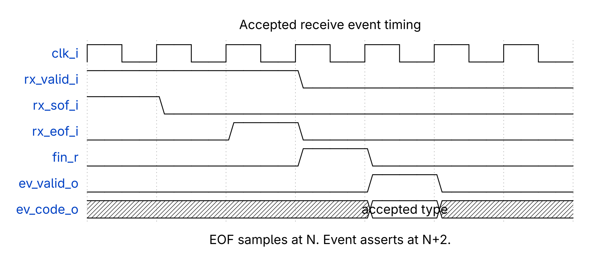
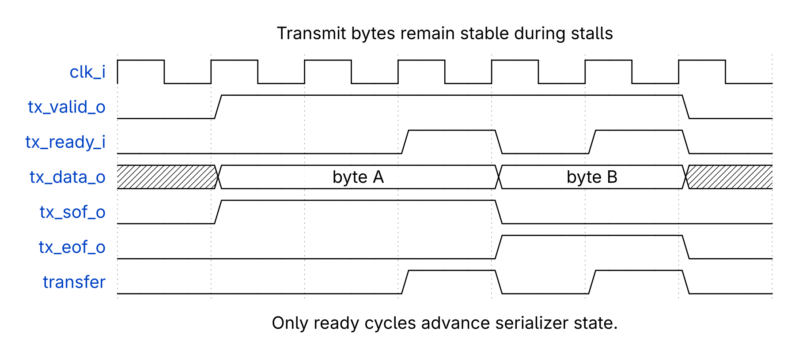

<!-- SPDX-License-Identifier: CERN-OHL-W-2.0 -->
# HDL developer guide

This guide explains structure, timing, and invariants.

The editable source remains [available](diagrams/gptp_architecture.drawio).

## Module map

| Module | Responsibility |
|---|---|
| `KL_gptp_engine` | Integration, queues, state, arbitration |
| `KL_gptp_rx_parser` | Byte parsing and message banking |
| `KL_gptp_ucpu` | Microcode execution and arithmetic |
| `KL_gptp_tx_slot` | Frame construction and serialization |
| `KL_gptp_timer` | Eight millisecond deadline slots |
| `gptp_ucpu_pkg` | Opcodes, constants, event identifiers |

All modules use one clock domain.

## Receive path

The parser accepts one byte each valid cycle.

It validates headers before dispatching events.

A receive error on any byte refuses its frame.

Accepted data enters ping-pong message banks.

Ingress timestamps follow the same bank selection.

Announce uses one frozen context.

Chasing Announces become counted drops.

Other event types may continue.

### Receive timing

EOF stores the final parser decision.

Finalization occupies the next cycle.

The accepted event follows finalization.

[WaveDrom source](diagrams/wavedrom/rx_accept.json) defines this timing.

## Event arbitration

- Four entries buffer parser and timer events.
- Parser events win simultaneous queue pushes.
- Timer expiry waits using valid-ready flow control.
- Timestamp results use a priority side path.
- Dispatch waits until serialization becomes idle.
- Later requests wait behind response ownership.

Never bypass ownership without preserving context.

## Egress result ownership

One result is accepted per valid-ready beat.

Its value, tag, outcome and generation latch together.

Readiness falls until that result dispatches.

A later offer therefore waits at its producer.

Backpressure can never replace an earlier result.

The dispatched word carries outcome and generation.

Both ride above the masked claim comparison.

## Retained pairing context

A peer answer can precede our own transmit time.

The completed pair then waits for that time.

Its identity and measurements stay in scratch.

A later response cannot rewrite the waiting pair.

Responder bookkeeping still counts every matching response.

Only the waiting pair's own arrival releases it.

Reset-backed validity guards both retained pairing cells.

A measured zero remains a valid time.

## State regions

The microCPU uses `st_addr_o[19:16]` for selection.

| Region | Access | Contents |
|---:|---|---|
| 0 | Read-only | Ping-pong message banks |
| 1 | Read-only | Ingress time, egress time, credit |
| 2 | Read-write | Sixty-four protocol scratch words |
| 3 | Read-write | Publication staging bank |
| 4 | Read-write | PHC controls and policy completion qualifier |
| 5 | Write-only | Timer arming interface |

Scratch storage survives warm resets.

Resettable claim-valid bits do not survive.

Pairing validity bits do not survive either.

The PHC slew qualifier also resets independently.

Microcode writes its remaining completion pairs through PHC word 2.

Nonzero decisions immediately assert `phc_slew_active_o`.

A zero decision clears it with the next rate write.

PHC word 3 retires an active correction during mastership.

Publication flags also control qualification through an RTL-owned hook.

Region 3, word 2 writes trigger this hook.

Bit 2 means asCapable; bit 3 means sync-ok.

Either cleared bit reloads two completion pairs while active.

The hook preserves the active level and applied rate.

While inactive, these writes must leave qualification unarmed.

Preserve this coupling when changing either region or flag.

## MicroCPU shape

- ROM contains 1,024 forty-eight-bit instructions.
- Register storage contains sixteen sixty-four-bit words.
- Integer logic supports common sixty-four-bit operations.
- Shifts run serially.
- Signed multiplication uses inferred DSP resources.
- Unsigned division runs serially.
- Dispatch preloads event and timestamp registers.
- Multi-cycle operations hold execution safely.

Protocol rates tolerate serial arithmetic.

## Transmit timing

Valid remains asserted during stalls.

Data and markers remain stable during stalls.

State advances only after ready acceptance.

[WaveDrom source](diagrams/wavedrom/tx_backpressure.json) defines this timing.

## Publication invariant

Microcode stages publication values first.

`OP_COMMIT` exposes the complete staged tuple.

Consumers sample only during `pub_commit_o`.

Inactive path entries must remain zero.

## Out-of-context measurement

`make ooc` synthesizes both tops out of context.

Each script first reads `syn/ooc/ooc_clock.xdc`.

That file defines the 10 ns `clk_i` clock.

Synthesis therefore optimizes against that period.

`syn/ooc/check_ooc_clock.py` fails runs that break this order.

It checks both scripts before Vivado starts.

Afterwards it checks each log and timing report.

The log must parse this repository's XDC inside synthesis.

Neither log may carry a critical warning.

Each timing report must show `clk` at 10 ns.

Its `report_clocks` section must bind `clk` to `clk_i`.

No register may lack a clock.

Measured at main `5dce647a` on 2026-10-11:

| Top | Flow | LUTs | Registers | BRAM tiles | DSPs | WNS |
|---|---|---:|---:|---:|---:|---:|
| `KL_gptp_engine` | Constrained | 4,852 | 3,652 | 1.5 | 4 | +1.773 ns |
| `KL_gptp_engine` | Unconstrained | 4,853 | 3,652 | 1.5 | 4 | +1.773 ns |
| `KL_gptp_ucpu` | Constrained | 1,643 | 733 | 1.5 | 4 | +1.941 ns |
| `KL_gptp_ucpu` | Unconstrained | 1,643 | 733 | 1.5 | 4 | +1.941 ns |

Both flows used Vivado 2026.1 and `xc7a100tfgg484-2`.

Both used `-mode out_of_context` and the default directive.

Constrained runs read the clock before `synth_design`.

Unconstrained runs created it after `synth_design`.

Unconstrained slack is only a post-synthesis report.

This repository's `syn/ooc` figures before #70 were unconstrained.

No placement or routing runs here.

## Change checklist

- Preserve single-clock assumptions.
- Preserve valid-ready transfer rules.
- Preserve bank and timestamp pairing.
- Preserve event ownership snapshots.
- Preserve reset-validity separation.
- Preserve accepted-result immutability.
- Preserve message scope on every cancellation.
- Gate only the three initiating legs.
- Update microcode and tests together.
- Add negative and boundary tests.
- Update both WaveDrom sources when timing changes.
- Update Draw.io after structural changes.
- Regenerate every committed diagram.
- Keep the OOC clock ahead of synthesis.
- Run lint and complete simulations.
