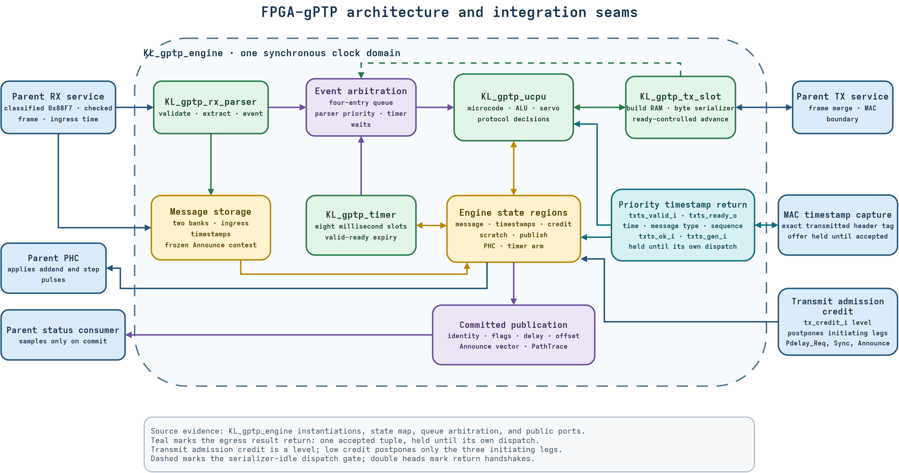

<!-- SPDX-License-Identifier: CERN-OHL-W-2.0 -->
# System integration guide

This guide defines the external engine contract.



## Parent ownership

Parent integration enables [`GPTP_PLANE_EN_P` by default](https://github.com/kebag-logic/milan-fpga/blob/ac2c5e77bba1c0ae20ce2f69f711a1d17ead94a5/hdl/milan/milan_datapath.sv#L73).

[Fabric gPTP](https://github.com/kebag-logic/milan-fpga/blob/ac2c5e77bba1c0ae20ce2f69f711a1d17ead94a5/docs/design/GPTP_PLANE.md#L6) owns product time synchronization.

[One atomic bank](https://github.com/kebag-logic/milan-fpga/blob/ac2c5e77bba1c0ae20ce2f69f711a1d17ead94a5/docs/design/GPTP_PLANE.md#L48) supplies every public consumer.

The disabled mode supports [verification-only comparison builds only](https://github.com/kebag-logic/milan-fpga/blob/ac2c5e77bba1c0ae20ce2f69f711a1d17ead94a5/docs/design/GPTP_PLANE.md#L49).

Product configurations [cannot disable the plane](https://github.com/kebag-logic/milan-fpga/blob/ac2c5e77bba1c0ae20ce2f69f711a1d17ead94a5/docs/design/GPTP_PLANE.md#L43-L44).

These references pin parent `dev` at `ac2c5e77`.

This repository contains no nested submodules.

Parent integration owns these surrounding services:

- Frame classification and receive buffering.
- Frame-check validation before engine delivery.
- MAC-boundary egress timestamp capture.
- PHC implementation and adjustment application.
- Publication capture after commit.
- Per-configuration microcode generation.

### Option-off behavior

`GPTP_PLANE_EN_P=0` has [no supported product image](https://github.com/kebag-logic/milan-fpga/blob/ac2c5e77bba1c0ae20ce2f69f711a1d17ead94a5/docs/ARCHITECTURE_HW_SW_SPLIT.md#L165).

This verification path has [zero runtime gPTP owners](https://github.com/kebag-logic/milan-fpga/blob/ac2c5e77bba1c0ae20ce2f69f711a1d17ead94a5/README.md#L167-L170).

| Surface | Option-off behavior | Parent evidence |
|---|---|---|
| Control TX | Passes straight through | [Datapath bypass](https://github.com/kebag-logic/milan-fpga/blob/ac2c5e77bba1c0ae20ce2f69f711a1d17ead94a5/hdl/milan/milan_datapath.sv#L7614-L7624) |
| PHC rate and phase controls | Select the CSR face | [PHC selection](https://github.com/kebag-logic/milan-fpga/blob/ac2c5e77bba1c0ae20ce2f69f711a1d17ead94a5/hdl/milan/milan_datapath.sv#L2850-L2858) |
| PHC settime | Remains on the CSR face | [Epoch control](https://github.com/kebag-logic/milan-fpga/blob/ac2c5e77bba1c0ae20ce2f69f711a1d17ead94a5/hdl/milan/milan_datapath.sv#L2850-L2852) |
| GM, parent, PathTrace, peer delay | Zero | [Safe publications](https://github.com/kebag-logic/milan-fpga/blob/ac2c5e77bba1c0ae20ce2f69f711a1d17ead94a5/README.md#L167-L170) |
| Sync and asCapable | Zero | [Safe health](https://github.com/kebag-logic/milan-fpga/blob/ac2c5e77bba1c0ae20ce2f69f711a1d17ead94a5/README.md#L167-L170) |
| AVTP `tu` | One | [Uncertain time](https://github.com/kebag-logic/milan-fpga/blob/ac2c5e77bba1c0ae20ce2f69f711a1d17ead94a5/README.md#L167-L170) |
| Publication writes | Inert; cannot manufacture live state | [Write behavior](https://github.com/kebag-logic/milan-fpga/blob/ac2c5e77bba1c0ae20ce2f69f711a1d17ead94a5/README.md#L167-L170) |

Review the [remaining acceptance gaps](MANAGER.md#open-risks) before product adoption.

## Clock and reset

- `clk_i` clocks every functional engine block.
- `rst_n` is synchronous and active-low.
- Reset clears queues, timers, and pending events.
- Scratch memory preserves warm-reset protocol state.
- Reset invalidates outstanding timestamp claims.
- Reset invalidates retained Pdelay pairing state.
- Reset invalidates the retained best-vector record.
- Reset loads and commits the self publication.
- Bootstrap microcode rearms required cadences.

Keep every input synchronous to `clk_i`.

## Receive interface

| Signal | Direction | Contract |
|---|---|---|
| `rx_valid_i` | Input | Qualifies each presented byte |
| `rx_data_i[7:0]` | Input | Carries destination-MAC-first bytes |
| `rx_sof_i` | Input | Marks the first byte |
| `rx_eof_i` | Input | Marks the final byte |
| `rx_err_i` | Input | Refuses the frame from any byte |
| `rx_ts_i[63:0]` | Input | Stable during the SOF transfer |

Parent sends preclassified `0x88F7` frames.

Parent removes frames failing frame checks.

No receive-ready signal exists.

The engine never backpressures receive traffic.

`rx_valid_i` may insert gaps between bytes.

Assert receive errors with any byte of the frame.

Each refused frame counts exactly one drop.

A refused frame raises no event.

No bank write follows the flagged byte's own edge.

Words written up to that edge are undefined.

No event references a refused frame's words.

The next accepted event reads only its own frame.

Pulsed and held errors refuse alike.

Errors raised between valid bytes are ignored.

Current parent integration drives `rx_err_i` low.

[Issue #35](https://github.com/Mister-M-alt/FPGA-gPTP/issues/35) records this any-byte contract.

[Its bank ruling](https://github.com/Mister-M-alt/FPGA-gPTP/issues/35#issuecomment-6105869522) sets the write boundary.

## Transmit interface

| Signal | Direction | Contract |
|---|---|---|
| `tx_valid_o` | Output | Qualifies every output byte |
| `tx_data_o[7:0]` | Output | Carries destination-MAC-first bytes |
| `tx_sof_o` | Output | Marks the first transfer |
| `tx_eof_o` | Output | Marks the final transfer |
| `tx_ready_i` | Input | Accepts the current byte |

A transfer needs both valid and ready.

Outputs remain stable while ready stays low.

The serializer blocks new event dispatches.

## Egress timestamp results

| Signal | Direction | Contract |
|---|---|---|
| `txts_valid_i` | Input | Offers one complete result |
| `txts_ready_o` | Output | Accepts the offered result |
| `txts_ns_i[63:0]` | Input | Carries boundary time |
| `txts_seq_i[15:0]` | Input | Carries PTP sequence identifier |
| `txts_type_i[3:0]` | Input | Carries PTP message type |
| `txts_ok_i` | Input | Marks a measured result |
| `txts_gen_i[3:0]` | Input | Carries the producer generation |

A transfer needs both valid and ready.

Hold every offered field stable until acceptance.

Never replace an unaccepted offer.

Ready stays low throughout reset.

Ready stays low until dispatch consumes the result.

Return tags must match transmitted headers.

Provide bounded result storage upstream of this interface.

This interface never assumes elapsed time supplies space.

### Lost results

A cleared `txts_ok_i` reports an explicitly lost result.

Such a result carries no usable time.

It retires only the claim its tag names.

It builds no timestamped Follow_Up companion.

A lost request result cancels that request's pairing.

A lost Sync result leaves that pairing untouched.

A lost response result leaves that pairing untouched.

Current microcode reads no generation field.

## Transmit admission credit

| Signal | Direction | Contract |
|---|---|---|
| `tx_credit_i` | Input | Permits initiating transmissions |

Drive credit as a level, never a pulse.

Low credit postpones three initiating beats.

Those beats are Pdelay_Req, Sync and Announce.

Each postponed beat retries at its next cadence.

Responses and both companions always keep service.

Low credit also postpones request interval bookkeeping.

Restore credit to resume every normal cadence.

## PHC control

| Output | Meaning |
|---|---|
| `phc_addend_we_o` | Applies one rate update |
| `phc_addend_o[31:0]` | Carries signed Q8.24 ns-per-tick rate trim |
| `phc_step_we_o` | Applies one phase step |
| `phc_step_o[63:0]` | Carries signed phase adjustment nanoseconds |
| `phc_slew_active_o` | Registered level covering transient policy correction |

Treat each write-enable as a pulse.

Apply its data during that cycle.

### Pulse semantics

Each write-enable stays high for exactly one `clk_i` cycle.

Consumed slave Sync and Follow_Up pairs write corrections.

Mastership also retires any active slave correction.

That transition writes the integral-only rate, without stepping.

Each consumed pair writes exactly one addend pulse.

At most one step pulse precedes that addend pulse.

Add `phc_step_o` to PHC time on its pulse.

A step carries the measured offset, negated.

Its addend then carries the retained rate estimate alone.

Each addend pulse replaces the previous rate trim.

The addend is signed; a negative trim slows the PHC.

Both data outputs hold their values between pulses.

Reset zeroes both data outputs.

Each step pulse is exactly one phase step.

### Peer delay across a phase step

A servo step invalidates the crossing rate-estimation history.
It retains the last valid ratio and link delay.
The next clean exchange seeds a new rate window.
A complete overlapping exchange still proves peer liveness.
Its mixed-epoch timestamps cannot replace the retained delay.
Ordinary missing-response and multiple-responder accounting remains active.
The next request resumes measurement normally.

These references are from IEEE 802.1AS-2020.

| Clause | Responsibility |
|---|---|
| 11.2.2 | Capability through peer delay |
| 11.2.19.3.3 | Neighbour rate estimation |
| 11.2.19.3.4 | Link-delay calculation |
| 11.2.20 | Responder timestamp pair |

Parent issue #621 exercises both signed 10 ms steps.
Its real-counter regression uses an independent peer LocalClock.
The parent integration test checks media and public counters.

Count step pulses to count phase steps.

### Step versus slew policy

[Issue #68](https://github.com/Mister-M-alt/FPGA-gPTP/issues/68) records this policy.

[The owner's decision](https://github.com/Mister-M-alt/FPGA-gPTP/issues/68#issuecomment-5794731372) sets both thresholds.

[The manager's ruling](https://github.com/Mister-M-alt/FPGA-gPTP/issues/68#issuecomment-5798089412) defines link-up.

The offset is local time minus grandmaster time.

| Servo state | Slews up to | Steps above |
|---|---|---|
| Link-up | 20 us | 20 us |
| Locked | 100 us | 100 us |

An offset of exactly the threshold slews.

Every other pair runs the PI rate path.

This includes ordinary tracking and transient offset correction.

#### Link-up

A link-up pair is the first after asCapable rises.

Every reset clears asCapable, so every reset re-arms link-up.

Nothing else re-arms the 20 us threshold.

#### Locked

Every consumed pair locks the servo.

Only an asCapable fall and rise unlocks it.

These events clear the synchronization verdict and keep the lock:

- A grandmaster identity change.
- This plane returning from grandmaster duty.

A 375 ms Sync receipt timeout ages the grandmaster instead.

This plane then becomes grandmaster, which sets the verdict.

Becoming grandmaster keeps the lock.

A grandmaster failover through a Sync lapse stays locked.

So the next pair uses the 100 us threshold.

A new parent under the same grandmaster changes nothing.

#### Rate envelope

The trim sums a proportional and an integral term.

That whole trim never exceeds 200 ppm in magnitude.

The integrator is clamped to the same bound.

In addend units the bound is this integer expression:

```text
(200 * 2^24 * 1000 + clk_hz / 2) / clk_hz
```

Here `clk_hz` is the generator's `--clk-hz` value.

The division truncates, so the bound rounds half up.

Derive a consumer's addend envelope from this expression.

That consumer then accepts every trim the plane writes.

When consumption stops, the last trim stays applied.

That held trim is inside the bound too.

A 100 us slew needs at least 0.5 s.

The master's own rate offset shares the 200 ppm bound.

So a real slew can take much longer.

A slew can overshoot while its trim rides the bound.

A master over 200 ppm apart outruns the trim.

Its offset then grows past 100 us and steps.

#### Slew-active level

[Issue #75](https://github.com/Mister-M-alt/FPGA-gPTP/issues/75) defines the consumer indication.

`phc_slew_active_o` is a registered, `clk_i`-synchronous level.

It marks transient offset correction through the rate path.

The policy distinguishes correction from ordinary frequency tracking.

Its tracking band is inclusive: -100 ns through +100 ns.

This tolerance does not change either step threshold.

The existing PI arithmetic and rate clamp remain unchanged.

| Consumed pair | Policy decision |
|---|---|
| Offset exceeds the applicable step threshold | Step; no new slew |
| Non-stepping offset outside the tracking band | Start or continue correction |
| First consecutive pair inside the band | Keep an existing correction active |
| Second consecutive pair inside the band | Complete the correction |
| Tracking inside the band without an active correction | Stay inactive |

Every outside-band pair restarts the two-pair completion qualification.

One zero crossing therefore cannot complete a correction.

The decision precedes the affected addend write.

The level rises when microcode publishes that decision.

It stays high throughout the interval between consumed pairs.

Completion clears it alongside that pair's replacement addend pulse.

Ordinary PI tracking continues, including nonzero frequency trims.

A step alone never raises this level.

Neither the synchronization flag nor addend magnitude determines it.

| Event | Level and correction behavior |
|---|---|
| Synchronous reset | Clear level and qualification immediately |
| Warm reset | Retained scratch cannot revive the level |
| asCapable loss | Hold level and applied rate; restart completion qualification |
| Missing Sync; 375 ms receipt timeout | Ages the grandmaster; becoming grandmaster applies |
| Missing Follow_Up; 125 ms timeout | Discard pending pair; retain level and rate |
| Grandmaster identity change | Hold level and rate; restart qualification |
| Replacement step | Hold through step; clear with its integral-only addend |
| Becoming grandmaster | Replace active correction with integral-only rate; clear together |
| Returning to slave duty | Next consumed pair makes the policy decision |

Reset the consumer's retained rate when resetting the engine.

Loss of capability alone cannot remove an applied correction.

A held slew can therefore remain active indefinitely.

There is no elapsed-time completion or 0.5 s watchdog.

Completion follows the measured policy verdict above.

Sample this level with the PHC control signals.

It is independent of `pub_commit_o`.

Consumers must preserve alignment with their effective PHC rate.

Discard every measurement window overlapping the level's high interval.

A partly overlapping window remains affected after deassertion.

The parent must carry this level through `KL_gptp_shadow`.

That consumer connection belongs to [parent #545](https://github.com/kebag-logic/milan-fpga/issues/545).

#### Publication during a slew

`pub_flags_o` bit 3 publishes the synchronization verdict.

Every consumed pair raises it, stepping or slewing.

So a slew may still be in progress.

Its remaining offset is at most 100 us.

`pub_offset_o` carries each pair's offset before correction.

It holds only the low 32 bits.

Offsets beyond about 2.147 s therefore wrap.

Such a pair always steps.

## Publication

The engine publishes protocol state as wires.

Sample outputs when `pub_commit_o` rises.

| Output group | Contents |
|---|---|
| Identity | Grandmaster and parent identities |
| Status | Presence, mastership, capability, synchronization |
| Measurements | Peer delay and signed offset |
| Announce | Raw selected priority vector |
| Path | Count plus seven retained tail identities |

Zero path count means no received PathTrace.

Counts include the separately published grandmaster.

Retained paths contain at most eight identities.

Inactive path entries remain zero.

### Path of an elected peer

[Issue #85](https://github.com/Mister-M-alt/FPGA-gPTP/issues/85) records this rule.

802.1AS-2020 clause 10.3.13.2.4 defines it.

Its item f5 is the slave port case.

The path is the received pathSequence plus thisClock.

thisClock is therefore the last published entry.

A directly attached grandmaster publishes two entries.

An absent PathTrace still publishes count zero.

Seven received entries fill all eight slots.

Longer received paths publish their first eight entries.

Those entries are also pathTrace's first eight.

The grandmaster and its path change in one commit.

### Before any peer

[Issue #82](https://github.com/Mister-M-alt/FPGA-gPTP/issues/82) defines this self publication.

802.1AS-2020 clause 10.3.13.2.4 requires it.

Every reset leaves no port vector.

This plane is then its own grandmaster.

The grandmaster output names thisClock.

The path holds one entry: thisClock.

Parent identity keeps its reset value.

Flags carry gmPresent alone, or nothing with priority1 255.

Reset loads exactly this state into the publication bank.

The engine commits it on the first edge after release.

Cold starts and warm resets behave alike.

No microcode runs before that commit.

thisClock is data in the generated microcode image.

The engine reads it there at configuration.

### Grandmaster presence

Flags bit 0 publishes gmPresent.

802.1AS-2020 10.3.13.2.4 g) defines it.

A priority1 below 255 makes thisClock grandmaster-capable.

The image marks that capability beside thisClock.

A capable thisClock sets gmPresent in every publication.

That includes reset, both departures and mastership.

With priority1 255, only an elected peer sets it.

### Grandmaster synchronization

[Issue #84](https://github.com/Mister-M-alt/FPGA-gPTP/issues/84) records this rule.

A grandmaster's own time is the domain's time.

So mastership counts as synchronized.

Flags bit 1 and bit 3 are therefore set together.

A Sync receipt timeout never clears bit 3 during mastership.

The parent derives tu from bit 3.

Its tu therefore clears during mastership.

Taking mastership from a peer changes the published grandmaster.

That change arms the parent's Annex B.1.1 holdover.

Handing mastership to a peer clears bit 3.

The first consumed Sync pair sets it again.

A self publication without mastership leaves bit 3 clear.

### Selection after reset

Scratch keeps the last best-vector record across warm resets.

That retained record cannot compete after a reset.

Only a newly received Announce can be elected.

A peer worse than this plane leaves thisClock selected.

A better peer wins through normal selection.

### Departure of the elected peer

Three departures each return thisClock and {thisClock}.

Announce silence for 3 s ages the peer out.

So do 375 ms without a usable Sync pair.

A usable pair is a Sync with its own Follow_Up.

802.1AS-2011 10.3.11 states that rule.

Cor1 corrects its Figure 10-13.

It holds while the peer keeps announcing.

A missing or late Follow_Up is not usable.

Nor is one naming another sequenceId.

An asCapable port then becomes grandmaster.

Adopting a new grandmaster starts its 375 ms Sync watch.

A grandmaster never sending usable Sync is aged too.

A port aged by Sync stays aged until usable Sync.

Until then its Announces are aged at once.

So this plane stays grandmaster while that Sync stays broken.

As grandmaster it still pairs that peer's Sync and Follow_Up.

Such a pair steers nothing and publishes nothing.

The next Announce after it elects the peer again, once.

An asCapable rise also clears that aged state.

Losing asCapable drops the peer's vector at once.

That drop commits within about one millisecond.

Its commit clears the sync and mastership flags.

gmPresent stays set for a capable thisClock.

It leaves PHC control and the slew level untouched.

Announces on an incapable port elect nothing.

Restored capability lets the best live peer win.

Without Announces, mastership follows within one receipt interval.

### Lost Pdelay responses

802.1AS-2011 Figure 11-8 counts lost responses.

Cor1 and Cor2 correct that figure.

Each 1 s interval without a completed exchange counts one.

That includes a Pdelay_Resp whose Follow_Up never comes.

A second Pdelay_Resp for the outstanding request resets the exchange.

That reset also counts one, from either responder.

Four consecutive losses keep asCapable.

The fifth consecutive loss clears it.

A completed exchange restarts the count.

## Microcode configuration

Generate one image for each hardware configuration.

```sh
python3 hdl/ucode/gen_gptp_ucode.py \
  --mac 02:a1:b2:c3:d4:e5 \
  --p1 248 \
  --clk-hz 100000000 \
  -o /tmp/gptp_ucode.hex
```

Set `UCODE_HEX_P` to that generated image.

The engine also reads thisClock from that image.

Set `CLK_HZ_P` to the actual engine frequency.

## Integration checklist

- Use one shared synchronous clock.
- Deliver complete validated frames.
- Preserve byte order and frame markers.
- Hold transmit readiness correctly.
- Return exact timestamp tags.
- Hold result offers until acceptance.
- Report unmeasured results explicitly.
- Drive admission credit as a level.
- Apply PHC pulses once.
- Count each step pulse as one step.
- Align the slew level with effective rate changes.
- Derive addend envelopes from the generator clock.
- Capture publication only on commit.
- Review the open interface risk.
- Run every repository gate.
